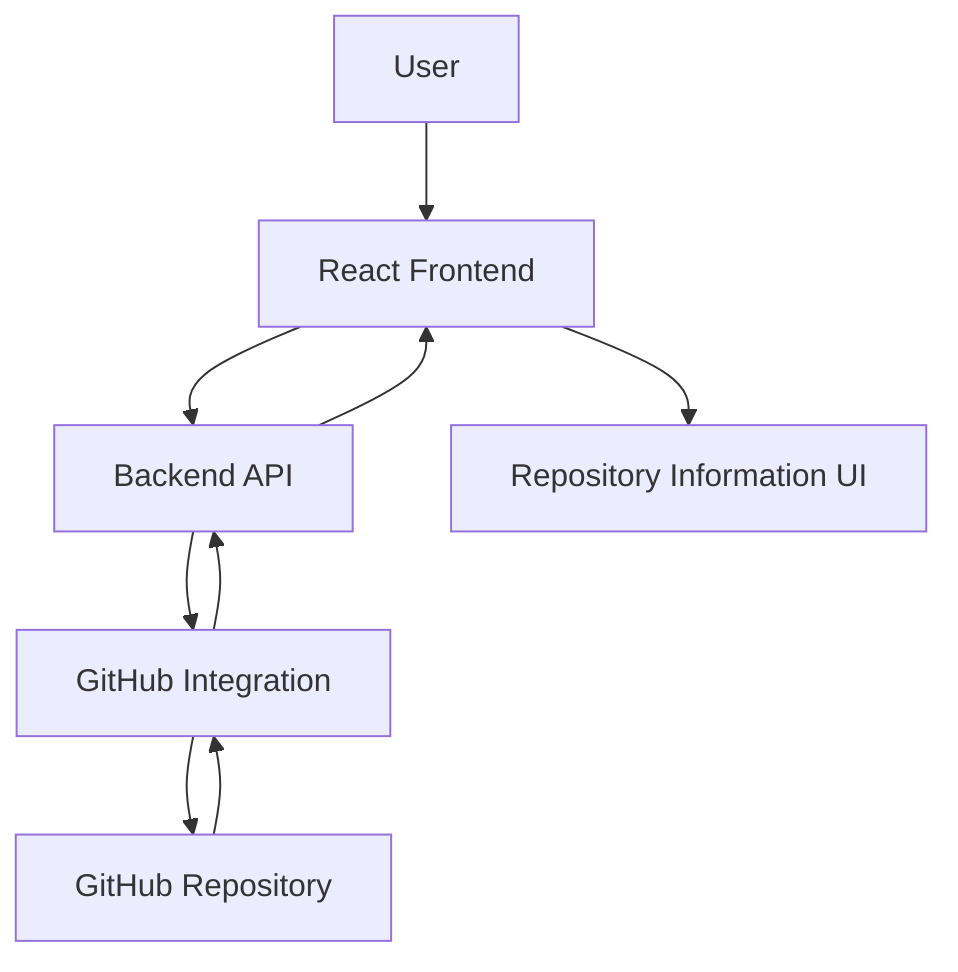

# 🚀 ResearchPilot AI

### AI-Powered GitHub Repository Analysis & Research Assistant

ResearchPilot AI is an intelligent research assistant designed to help developers understand, explore, and analyze GitHub repositories and their codebases. It aims to simplify repository exploration by organizing project information and helping users understand the structure and implementation of software projects.

---

## 📌 Table of Contents

- [About the Project](#-about-the-project)
- [Problem Statement](#-problem-statement)
- [Key Features](#-key-features)
- [Technology Stack](#-technology-stack)
- [Project Architecture](#-project-architecture)
- [Project Structure](#-project-structure)
- [Installation and Setup](#-installation-and-setup)
- [Running the Application](#-running-the-application)
- [How It Works](#-how-it-works)
- [Future Enhancements](#-future-enhancements)
- [Contributing](#-contributing)
- [Author](#-author)
- [License](#-license)

---

## 📖 About the Project

Understanding an unfamiliar software repository can be challenging, especially when it contains multiple folders, files, classes, functions, and dependencies.

ResearchPilot AI is being developed to make this process easier.

The application provides a platform for connecting with GitHub repositories and exploring their project information and code structure.

The goal is to reduce the time developers spend manually navigating large codebases and provide a more organized approach to software project research.

## 🎯 Problem Statement

Developers frequently face difficulties when exploring unfamiliar repositories:

- Understanding large and complex project structures.
- Identifying important source files and components.
- Navigating between different modules.
- Understanding how different parts of a project are organized.
- Spending significant time manually inspecting code.

ResearchPilot AI aims to address these challenges through an integrated repository analysis interface.

## ✨ Key Features

### 1. GitHub Repository Integration
- Accept GitHub repository URLs.
- Retrieve repository information.
- Validate GitHub repository URLs.
- Process repository information for further exploration.

### 2. Repository Analysis
- Explore repository contents.
- Understand the organization of project files.
- Identify relevant code components.
- Display available repository information.

### 3. Code Structure Exploration
- Explore classes and other code elements.
- View associated file information.
- Display source file locations and line references where available.

### 4. Interactive Dashboard
- Centralized project interface.
- Organized navigation.
- Structured presentation of repository information.

### 5. Modern User Interface
- React-based frontend.
- Organized project navigation.
- Component-based interface architecture.

*Note: Features listed here describe the intended and observed project functionality. Exact implementation and availability depend on the current application version.*

## 🛠️ Technology Stack

| Technology | Purpose |
|---|---|
| Python | Backend development |
| FastAPI | Backend API framework |
| React.js | Frontend development |
| Vite | Frontend development and build tooling |
| JavaScript | Frontend functionality |
| CSS | User interface styling |
| Git | Version control |
| GitHub | Source code hosting and repository integration |

## 🏗️ Project Architecture

ResearchPilot AI follows a frontend-backend architecture.



### Architecture Components

**Frontend**
- Provides the user interface.
- Accepts repository information.
- Displays retrieved project details.

**Backend**
- Handles API requests.
- Processes repository-related operations.
- Coordinates GitHub repository integration.

**GitHub Integration**
- Validates repository URLs.
- Retrieves repository information.
- Supports repository ingestion.

## 📂 Project Structure

The project is organized into separate frontend and backend directories.

```text
ResearchPilot-AI/
│
├── backend/
│   ├── app/
│   │   └── project_ingestion/
│   │       └── github_handler.py
│   │
│   └── .venv/
│
├── frontend/
│   ├── src/
│   │   ├── App.jsx
│   │   └── App.css
│   │
│   ├── package.json
│   └── ...
│
├── .gitignore
└── README.md
```

*The structure above highlights known project components. Other files and directories may exist in the repository.*

## ⚙️ Installation and Setup

### Prerequisites

Install the following before running the project:

- Python 3.10 or later
- Node.js and npm
- Git
- A GitHub account

### 1. Clone the Repository

```bash
git clone https://github.com/faizaan-git/ResearchProject.git
```

### 2. Navigate to the Project

```bash
cd ResearchProject
```

### 3. Backend Setup

Navigate to the backend directory:

```bash
cd backend
```

Create a virtual environment:

```bash
python -m venv .venv
```

Activate the virtual environment on Windows:

```powershell
.venv\Scripts\Activate.ps1
```

Install backend dependencies using the project's dependency file:

```bash
pip install -r requirements.txt
```

### 4. Frontend Setup

Open another terminal:

```bash
cd frontend
```

Install frontend dependencies:

```bash
npm install
```

## ▶️ Running the Application

### Start the Backend

Activate the backend virtual environment and use the actual backend application entry point.

For a FastAPI application whose entry point is `app.main:app`, the command would be:

```bash
uvicorn app.main:app --reload
```

### Start the Frontend

Navigate to the frontend directory:

```bash
cd frontend
```

Run:

```bash
npm run dev
```

Open the local URL displayed in the terminal to access the application.

*The backend entry point, available npm scripts, and configuration values should be verified against the actual project files.*

## 🔄 How It Works

1. The user opens the ResearchPilot AI application.
2. The user provides a GitHub repository URL.
3. The backend validates the repository URL.
4. Repository information is retrieved through the GitHub integration.
5. The application processes the available repository information.
6. The frontend presents the retrieved information in an organized interface.

## 🔮 Future Enhancements

Potential improvements include:

- AI-powered code explanations.
- Automated project documentation generation.
- Advanced code dependency analysis.
- Repository architecture visualization.
- Intelligent bug detection and suggestions.
- Multi-language source code analysis.
- Code search and semantic search.
- Automated project report generation.
- Integration with additional development platforms.

These are proposed enhancements, not claims about currently implemented functionality.

## 🤝 Contributing

Contributions, suggestions, and feedback are welcome.

To contribute:

1. Fork this repository.
2. Create a new feature branch.
3. Make your changes.
4. Commit your changes.
5. Push the branch to GitHub.
6. Submit a Pull Request.

```bash
git checkout -b feature/your-feature-name
git add .
git commit -m "Add your feature"
git push origin feature/your-feature-name
```

## 👨‍💻 Author

**Faizaan**

GitHub: [@faizaan-git](https://github.com/faizaan-git)

Project: [ResearchPilot AI](https://github.com/faizaan-git/ResearchProject)

## 📄 License

License: Not specified.

If you intend to make this project open source, consider adding an appropriate license file.

---

⭐ **If you find ResearchPilot AI interesting, consider starring the repository!**

*Built to make software repository exploration easier and more accessible.*
